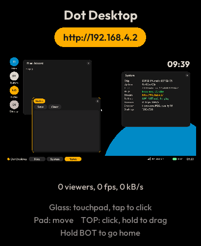

# Dot Desktop

A big desktop for the Kode Dot, on any screen with a browser. The Dot renders a desktop (a clock, battery and Wi-Fi status, and windows for the files on the microSD card, system information and a notepad) and streams it over Wi-Fi: open the Dot's address on a TV, a laptop or a phone and the desktop is there, 1280 x 720. Mouse and keyboard in the browser work on the desktop, and the Dot's own buttons and glass move the cursor too.

The look follows kodeOS: black page, Light Grey text, yellow pills, Outfit type.

> **Not tested on a real Kode Dot.** It was built with ESP-IDF v6.1 and kode-sdk v0.1.1 and run in the kode-sim emulator only. How fast it streams over real Wi-Fi, and the P4's JPEG engine on real silicon, are unknown. See "What is tested" below.

Dot Desktop is an independent app. It is not made or endorsed by Kode.



## Using it

1. Join a Wi-Fi network once in kodeOS (Settings). The app switches Wi-Fi on and joins the remembered network.
2. Start **Dot Desktop** from Apps. The Dot's glass shows the address, for example `http://192.168.1.57`, and a small picture of the desktop.
3. Open that address in a browser on the same network. **Full screen** in the corner hides the browser.

| Address | What |
|---|---|
| `http://<dot>/` | The desktop, with mouse and keyboard (WebSocket, only changed regions are sent) |
| `http://<dot>/tv` | A simple full-screen view for TV browsers without WebSocket (MJPEG, view only) |
| `http://<dot>/mjpeg` | The raw MJPEG stream (VLC, ffplay, an ``) |
| `http://<dot>/snap.jpg` | One screenshot |

### Controls

| On the Dot | Does |
|---|---|
| Glass | Touchpad: drag to move the cursor, tap to click |
| Pad | Move the cursor (it speeds up while held) |
| TOP | Mouse button; hold it and move to drag a window |
| BOT (hold) | Back to kodeOS |

In the browser: the mouse clicks and drags, the wheel scrolls the file list, the keyboard types into Notes. **Save** in Notes writes `/sdcard/notes.txt`; it is loaded again at the next start.

The **Display** window sets the desktop's size (1280x720, 1024x576 or 800x480) and the stream's JPEG quality; smaller and lower is faster on a slow network. Both are kept across restarts.

## How it works

- `desk.c` paints the desktop region by region into one frame in PSRAM (`fbshare.c`), which keeps a map of changed 16 x 16 tiles.
- `desk_ao.c`, the Active Object, never blocks: it only try-locks the frame. Input, Wi-Fi, battery and file events arrive as events.
- `stream.c` runs the HTTP server (port 80) and a stream task: changed tiles become rectangles, each is encoded as JPEG and sent over the WebSocket; the page draws them on a canvas. Up to 30 frames a second, slower when the network is.
- `jpeg_enc.c` uses the P4's JPEG engine; where there is none (the emulator) it falls back to the software encoder in `sw_jpeg.c`.

## What is tested

| Part | Status |
|---|---|
| Desktop rendering, fonts, layout | Host test (`test/desk_test.c`) and the emulator |
| Software JPEG encoder | Host test, decoded by Pillow (PSNR about 39 dB) |
| Build with ESP-IDF v6.1, internal-RAM budget (`check_ram.sh`) | Yes |
| kode-sim review (`test/scenario.json`): boot, install, Wi-Fi join, server up, pad, touch, home by hold | Passed |
| Viewer page, snapshot, WebSocket tiles, mouse and keyboard from the viewer, saving notes, changing the size | In the emulator, with `tools/ws_probe.py` through `kode-sim run --forward 18080:80` |

**Not tested on a real Dot:**

- **Frame rate and Wi-Fi throughput.** The emulator runs at a few frames a second, which says nothing about the board. The aim is 15 to 25 fps at 720p when little changes; a full-screen change is a 60 to 120 KB JPEG, so the real rate depends on your network and the C5 link.
- **The P4's JPEG engine.** The emulator models it; real speed and image quality are unmeasured. If the engine fails, the app falls back to the software encoder, which is much slower.
- **Joining Wi-Fi.** The app uses the network kodeOS remembers; in the emulator kode-sim joins its own test network.
- **The MJPEG view** (`/tv`, `/mjpeg`) and **TV browsers** in general.
- **Battery life** with Wi-Fi on and streaming.

---

## Building

ESP-IDF **v6.1**:

```bash
idf.py build
```

The first build fetches kode-sdk v0.1.1 from GitHub. The image is `build/dot_desktop.bin`.

## Installing

With `kcli.py` from a clone of the KodeOS repository:

```bash
python KodeOS/tools/kcli.py -p PORT install build/dot_desktop.bin
```

The board resets into kodeOS, installs the app and starts it. It stays in Apps.

## Fonts

`main/fonts_aa.c` is Outfit (SIL Open Font License 1.1, `tools/fonts/OFL-Outfit.txt`), rasterised by `tools/mkfont_ttf.py`. `main/font8x16.h` is Terminus (SIL OFL 1.1), made by `tools/mkfont.py`.

## Licence

GPL-3.0-or-later, like the SDK it links, with the additional permission for RFAL: see `LICENSE` and `NOTICE.md`. Kode, Kode Dot, kodeOS and Kody are trademarks of Kode; this app uses them only to say what it runs on.
